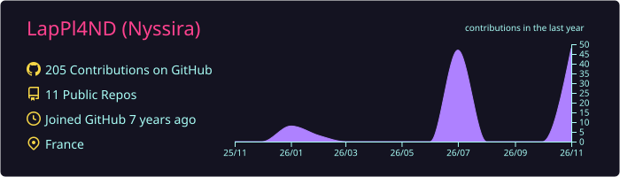
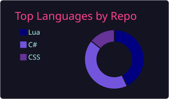
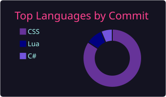
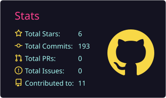
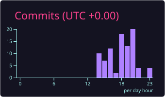

<!-- Bannière -->
<p align="center">
  
</p>

<p align="center">
  
</p>

<p align="center">
  
  
  
  
</p>

---

## 🌸 About Me

```cpp
#include <iostream>

struct Nyssira {
    std::string location   = "France 🇫🇷";
    std::string level      = "Beginner developer";
    std::string focus      = "Improving my C++ (ImGui) skills";
    std::string hobbies[4] = { "Anime & Manga", "Video Games", "Music", "Computers" };
    std::string motto      = "Build whatever comes to mind.";
};

int main() {
    Nyssira me;
    std::cout << "Thanks for visiting my profile! 🤍" << std::endl;
}
```

- 🔭 I build **websites**, **desktop apps** and **C++ projects with ImGui**
- 🌱 Currently leveling up my **C++** every day
- 🧪 I love experimenting with new technologies
- 💬 Ask me about **anime**, **games** or **anything computer-related**

---

## ⚡ Tech Stack

<p align="center">
  
</p>

---

## 🚀 Projects

<table align="center">
  <tr>
    <td align="center" width="50%">
      <a href="https://github.com/LapPl4ND/ImageGabe">
        
      </a>
      <br><br>
      Grab album covers & thumbnails from <b>Spotify</b> and <b>YouTube</b> in one click.
    </td>
    <td align="center" width="50%">
      <a href="https://github.com/LapPl4ND/LinkConvertisor">
        
      </a>
      <br><br>
      Convert music links to <b>MP3</b> or <b>MP4</b>. Built with <b>C#</b>.
    </td>
  </tr>
  <tr>
    <td align="center" width="50%">
      <a href="https://github.com/LapPl4ND/AnimApp">
        
      </a>
      <br><br>
      Keep track of the <b>anime</b>, <b>manga</b> and <b>webtoons</b> you're watching and reading.
    </td>
    <td align="center" width="50%">
      <a href="https://github.com/LapPl4ND/lappl4nd.github.io">
        
      </a>
      <br><br>
      My personal website, built with <b>HTML</b>, <b>CSS</b> and <b>JavaScript</b>.
    </td>
  </tr>
</table>

---

## 📊 GitHub Stats

<p align="center">
  
</p>

<p align="center">
  
  
</p>

<p align="center">
  
  
</p>

---

## 🎯 What I Like

| 💻 Programming | 🌸 Anime & Manga | 🎮 Video Games | 🎵 Music | 🖥️ Tech |
|:---:|:---:|:---:|:---:|:---:|

---

## 🌸 Mio

<p align="center">
  
</p>

---

<p align="center">
  <b>Thanks for stopping by 🤍 Have a wonderful day!</b>
</p>

<p align="center">
  
</p>
